# NEXUS AI — Distributed AI Agent Orchestration & Intelligence Platform

A high-performance, production-oriented distributed AI agent orchestration platform built with **Python 3.12**, **FastAPI**, **Google Gemini API (`google-genai`)**, **SQLAlchemy 2.0 (Async)**, **MySQL**, **LangGraph**, **Redis**, and **Celery**.

---

## 1. Project Overview

**NEXUS AI** is designed to coordinate specialized autonomous AI agents capable of planning, code generation, research, task execution, tool use, and distributed asynchronous execution.

### Completed Milestones:
- **Milestone 1: Database Persistence & Async Engine Baseline**
  - Asynchronous MySQL engine via `asyncmy` and SQLAlchemy 2.0.
  - Connection pooling with health-check pings and lifecycle recycling.
  - `Workflow` and `Task` execution state models with UTC timestamps and UUID primary keys.
  - Alembic asynchronous database migrations.
- **Milestone 2: Gemini API Integration & Reusable LLM Service Layer**
  - Official Google GenAI Python SDK (`google-genai`) integration.
  - Abstract provider interface (`BaseLLMProvider`) enabling multi-model extensibility.
  - Async `GeminiProvider` with bounded exponential backoff retries on transient failures (429, 503).
  - Strict Pydantic v2 structured output enforcement (`response_schema`).
  - Centralized prompt template management (`PromptTemplate`).
  - Precise per-request token usage tracking and tier-based USD cost computation.
  - Persistent database auditing in `llm_usage_costs`.
  - REST API endpoints for text and structured generation with standardized error handling.
- **Milestone 3: Specialized AI Agent Framework**
  - Standardized Pydantic v2 contracts (`AgentInput`, `AgentOutput`, `AgentExecutionStatus`).
  - Abstract base agent lifecycle (`BaseAgent`) with input validation, execution limits, timing, and error containment.
  - Seven specialized agents with versionable system prompts and structured outputs:
    1. **Supervisor Agent**: Classifies tasks and recommends agent delegation strategies.
    2. **Planner Agent**: Decomposes complex objectives into dependency-ordered subtasks.
    3. **Research Agent**: Synthesizes factual knowledge, documents assumptions, and flags verification needs.
    4. **Analysis Agent**: Evaluates options, detects trends, and performs comparative trade-off analysis.
    5. **Coding Agent**: Architects technical solutions, generates clean code, and identifies edge cases under strict non-execution boundaries.
    6. **Reviewer Agent**: Audits deliverables against criteria and issues structured verdicts (ACCEPT/REVISE/REJECT).
    7. **Report Generation Agent**: Formulates executive markdown reports with structured sections and missing evidence tracking.
  - Centralized thread-safe `AgentRegistry` and dependency-injecting `AgentFactory`.
  - Foundation `ControlledToolRegistry` with permission boundaries (`READ_ONLY`, `COMPUTE`, `RESTRICTED`).
  - Centralized `AgentExecutionService` with database auditing in `agent_executions`.
  - REST API routes for listing, inspecting, and executing individual specialized agents.
- **Milestone 4: LangGraph Multi-Agent Orchestration Engine**
  - Stateful multi-agent graph orchestration built on LangGraph (`StateGraph`).
  - Centralized `NexusState` schema with typed state, metadata, and accumulative reducers (`merge_dicts`, `append_unique`).
  - Dynamic conditional routing for supervisor classification, planner task breakdown, specialist parallel execution, and reviewer feedback loops.
  - Reviewer feedback loop with automatic revision count increments and bound enforcement (`max_revisions`).
  - Parallel fan-out / fan-in specialist execution with thread-safe result merging.
  - Checkpointing boundary adapter (`WorkflowCheckpointAdapter`) using in-memory state snapshots with clear delineation from MySQL persistence.
  - End-to-end `WorkflowExecutor` synchronizing LangGraph workflow runs with MySQL `workflows` and `tasks` persistence models.
  - REST API endpoints for triggering workflow execution, inspecting status, retrieving LangGraph state, and listing subtask history.
- **Milestone 5: Dynamic Planning & Intelligent Task Decomposition Engine**
  - Strongly typed planning contracts (`PlanningRequest`, `PlannedTask`, `ExecutionPlan`, `ExecutionStage`, `PlanningDecision`).
  - Dynamic task decomposition subsystem interacting with the existing Planner Agent and Gemini LLM service.
  - Deterministic and capability-based agent matching subsystem (`AgentCapabilityMatcher`) mapping subtasks to verified registered agents.
  - Pure Python Dependency Graph (DAG) engine with Kahn's algorithm topological sorting, self-dependency prevention, missing dependency checks, and 3-color DFS cycle detection.
  - Critical-path task prioritization (`TaskPrioritizer`) computing downstream blocked task counts and path lengths without violating DAG constraints.
  - Level-based parallel execution stage generator (`StageGenerator`) respecting concurrency limits.
  - Strict `PlanValidator` with bounded iterative repair loop preventing runaway re-planning.
  - Conservative `PlanOptimizer` performing transitive dependency reduction and safe duplicate task deduplication.
  - LangGraph planning integration with `plan_validator` node and dynamic conditional repair routing.
  - Database persistence models (`ExecutionPlanModel`, `PlanningIterationModel`) with Alembic migration `0004`.
  - Planning REST API endpoints (`/generate`, `/{id}`, `/{id}/tasks`, `/{id}/stages`).
- **Milestone 6: Distributed Task Execution Infrastructure**
  - Centralized Celery application (`app.workers.celery_app`) configured with direct exchange, logical queues (`default`, `research`, `analysis`, `coding`), strict JSON serialization (no pickle), `task_acks_late=True`, and `worker_prefetch_multiplier=1`.
  - Distributed worker tasks (`execute_agent_task`, `execute_research_task`, `execute_analysis_task`, `execute_coding_task`) with atomic task claiming, idempotency protection against duplicate delivery, exponential backoff retries, and isolated `NullPool` async database sessions.
  - Dependency-aware `DistributedTaskDispatcher` scheduling stage 1 unblocked tasks to Celery queues and automatically unblocking downstream stages upon task completion.
  - Worker registry & health diagnostics (`check_redis_health`, `list_active_workers`, `get_worker_health_summary`) with resilient degraded-mode handling when Redis or workers are offline.
  - REST API endpoints for plan submission (`/api/v1/execution/submit/{plan_id}`), execution progress & summary (`/api/v1/execution/{workflow_id}`), task monitoring (`/api/v1/execution/{workflow_id}/tasks`, `/api/v1/execution/tasks/{task_id}`), and worker fleet discovery (`/api/v1/workers/health`, `/api/v1/workers`).
- **Milestone 7: Fault Tolerance, Recovery & Self-Healing Execution**
  - Database-backed conditional task leases (`TaskLeaseManager`) with unique cryptographically secure tokens, expiration timeouts, renewal, and atomic CAS release preventing zombie worker overwrites.
  - Worker node heartbeat registry and failure detection (`WorkerFailureDetector`, `WorkerNodeModel`) classifying worker state (`ONLINE`, `SUSPECTED`, `OFFLINE`).
  - Automated self-healing recovery manager (`TaskRecoveryManager`) scanning orphaned/stuck tasks, making atomic recovery decisions (`REQUEUE`, `MARK_FAILED`, `MARK_CANCELLED`), and appending immutable audit records to `recovery_events`.
  - Typed error classification and bounded exponential backoff with jitter (`RetryPolicy`, `ErrorCategory`, `RetryDecision`).
  - Resilient 3-state LLM circuit breaker (`CircuitBreaker`: CLOSED $\to$ OPEN $\to$ HALF_OPEN $\to$ CLOSED) guarding external Gemini API calls and enabling fast failure during upstream outages.
  - DAG-aware workflow resumption (`WorkflowRecoveryService`) preserving completed deliverables and re-dispatching only incomplete unblocked tasks after cluster/application restarts.
  - Safe workflow execution cancellation (`WorkflowCancellationService`) revoking Celery worker tasks while safeguarding completed outputs.
  - Celery Beat background scheduler (`app.workers.scheduler`) running periodic lease reconciliation and worker failure sweeps.
  - Comprehensive self-healing REST API endpoints (`/api/v1/recovery/health`, `/workers`, `/tasks/expired`, `/tasks/stuck`, `/tasks/{id}`, `/workflows/{id}/resume`, `/workflows/{id}/history`, `/api/v1/execution/{id}/cancel`).
  - 149 passing automated tests (100% pass rate) with 88% overall test coverage and exhaustive 6-scenario fault injection suite.

---

## 2. Architecture Overview

```
                                  +---------------------------+
                                  |   HTTP Clients / Probes   |
                                  +-------------+-------------+
                                                |
                                                v
                                  +---------------------------+
                                  |     FastAPI Application   |
                                  |      (src/app/main.py)    |
                                  +-------------+-------------+
                                                |
             +-----------------------------------+-----------------------------------+-----------------------------------+
             |                                   |                                   |                                   |
             v                                   v                                   v                                   v
 +-----------------------+           +-----------------------+           +-----------------------+           +-----------------------+
 |  Health & Readiness   |           |    LLM Service API    |           |    Agents API Route   |           |   Workflows API Route |
 | GET /api/v1/health    |           | POST /api/v1/llm/...  |           | GET  /api/v1/agents   |           | POST /api/v1/workflows|
 | GET /api/v1/health/ready          +-----------+-----------+           | POST /api/v1/agents/..|           | GET  /api/v1/workfl...|
 +-----------+-----------+                       |                       +-----------+-----------+           +-----------+-----------+
             |                                   |                                   |                                   |
             v                                   |                                   v                                   v
 +-----------------------+                       |                       +-----------------------+           +-----------------------+
 |  Database Ping Check  |                       |                       | AgentExecutionService |           |   WorkflowExecutor    |
 | (check_database_health)                       |                       +-----------+-----------+           | (LangGraph Engine)    |
 +-----------+-----------+                       |                                   |                       +-----------+-----------+
             |                                   |                       +-----------+-----------+                       |
             |                                   v                       |                       |                       v
             |                       +-----------------------+           v                       v           +-----------------------+
             |                       |      LLMService       |  +-----------------+  +-----------------+     |   LangGraph StateGraph|
             |                       | (Token Telemetry/Cost)|  |  AgentRegistry  |  |  AgentFactory   |     |  (NexusState & Router)|
             |                       +-----------+-----------+  | (Thread-safe)   |  | (DI Container)  |     +-----------+-----------+
             |                                   |              +-----------------+  +--------+--------+                 |
             |                                   v                                            |                          v
             |                       +-----------------------+                                v              +-----------------------+
             |                       |    GeminiProvider     |                       +-----------------+     | CheckpointAdapter     |
             |                       | (google-genai Client) |                       |    BaseAgent    |     | (In-Memory Checkpoint)|
             |                       +-----------+-----------+                       |  (7 Specialized)|     +-----------+-----------+
             |                                   |                                   +--------+--------+                 |
             |                                   v                                            |                          |
             |                       +-----------------------+                                |                          |
             |                       | Google Gemini 2.5     |                                |                          |
             |                       +-----------------------+                                |                          |
             |                                   |                                            |                          |
             +-----------------------------------+--------------------------------------------+--------------------------+
                                                 |
                                                 v
                                   +---------------------------+
                                   |   SQLAlchemy ORM Models   |
                                   |  - workflows              |
                                   |  - tasks                  |
                                   |  - llm_usage_costs        |
                                   |  - agent_executions       |
                                   +---------------------------+
```

---

## 3. Directory Structure

```text
Distributed AI Agent Orchestration System/
├── .env.example                       # Environment configuration template
├── .gitignore                         # Source control exclusions
├── alembic.ini                        # Alembic migration configuration
├── pyproject.toml                     # Project packaging, tools & dependencies
├── README.md                          # Project documentation
├── alembic/                           # Database migration scripts
│   ├── env.py                         # Async migration runner
│   ├── script.py.mako                 # Migration script template
│   └── versions/                      # Migration revisions
│       ├── 0001_initial_workflows_and_tasks.py
│       ├── 0002_add_llm_usage_costs.py
│       ├── 0003_add_agent_executions.py
│       └── 0004_add_execution_plans_and_iterations.py
├── src/
│   └── app/
│       ├── __init__.py                # Package version
│       ├── main.py                    # FastAPI application & exception handlers
│       ├── agents/                    # Specialized AI Agent Framework (Milestone 3)
│       │   ├── __init__.py            # Agent exports
│       │   ├── base.py                # BaseAgent abstract class
│       │   ├── contracts.py           # AgentInput, AgentOutput, AgentConfig schemas
│       │   ├── factory.py             # AgentFactory dependency container
│       │   ├── registry.py            # Thread-safe AgentRegistry
│       │   ├── prompts/               # Versionable agent system prompts
│       │   │   ├── __init__.py
│       │   │   └── system_prompts.py  # Prompts for all 7 specialized agents
│       │   ├── specialized/           # Specialized agent implementations
│       │   │   ├── __init__.py
│       │   │   ├── analysis.py        # AnalysisAgent
│       │   │   ├── coding.py          # CodingAgent
│       │   │   ├── planner.py         # PlannerAgent
│       │   │   ├── report.py          # ReportGenerationAgent
│       │   │   ├── research.py        # ResearchAgent
│       │   │   ├── reviewer.py        # ReviewerAgent
│       │   │   ├── schemas.py         # Pydantic structured output models
│       │   │   └── supervisor.py      # SupervisorAgent
│       │   └── tools/                 # Controlled tool registry foundation
│       │       ├── __init__.py
│       │       └── registry.py        # ControlledToolRegistry & ToolDefinition
│       ├── api/
│       │   ├── __init__.py            # API router aggregator (/api/v1)
│       │   └── routes/
│       │       ├── __init__.py
│       │       ├── agents.py          # Agent management and execution endpoints
│       │       ├── health.py          # Health & readiness diagnostics
│       │       ├── llm.py             # LLM generation endpoints
│       │       ├── planning.py        # Dynamic planning endpoints (Milestone 5)
│       │       └── workflows.py       # Workflow orchestration endpoints (Milestone 4)
│       ├── core/
│       │   ├── __init__.py
│       │   ├── config.py              # Pydantic v2 centralized settings
│       │   ├── exceptions.py          # Domain, LLM, & Agent exception hierarchy
│       │   └── logging.py             # Structured logging configuration
│       ├── db/
│       │   ├── __init__.py            # DB exports
│       │   ├── base.py                # DeclarativeBase, UUID & Timestamp mixins
│       │   ├── dependencies.py        # FastAPI async session dependency (get_db)
│       │   ├── session.py             # AsyncEngine & connection pool
│       │   └── models/
│       │       ├── __init__.py
│       │       ├── agent_execution.py # Agent execution audit model (Milestone 3)
│       │       ├── execution_plan.py  # ExecutionPlan & PlanningIteration models (Milestone 5)
│       │       ├── llm_usage.py       # LLM token telemetry & cost audit model
│       │       ├── task.py            # Task persistence model
│       │       └── workflow.py        # Workflow persistence model
│       ├── orchestration/             # LangGraph Multi-Agent Engine (Milestone 4 & 5)
│       │   ├── __init__.py            # Orchestration exports
│       │   ├── checkpointer.py        # WorkflowCheckpointAdapter & MemorySaver
│       │   ├── executor.py            # WorkflowExecutor & DB synchronization
│       │   ├── graph.py               # StateGraph compilation & edge setup
│       │   ├── nodes.py               # OrchestrationNodes wrapping specialized agents
│       │   ├── router.py              # Dynamic conditional routing logic
│       │   └── state.py               # NexusState TypedDict & accumulative reducers
│       ├── planning/                  # Dynamic Planning Engine (Milestone 5)
│       │   ├── __init__.py            # Planning subsystem exports
│       │   ├── decomposer.py          # TaskDecomposer integrating Planner Agent
│       │   ├── graph.py               # DependencyGraph DAG engine, cycle check, Kahn sort
│       │   ├── matcher.py             # AgentCapabilityMatcher subsystem
│       │   ├── optimizer.py           # PlanOptimizer (transitive reduction, dedup)
│       │   ├── prioritizer.py         # TaskPrioritizer critical path analysis
│       │   ├── stages.py              # StageGenerator (parallel level grouping)
│       │   └── validator.py           # PlanValidator & bounded repair rules
│       ├── schemas/
│       │   ├── __init__.py
│       │   ├── agent.py               # Agent API request/response schemas
│       │   ├── health.py              # Health check Pydantic schemas
│       │   ├── llm.py                 # LLM request/response Pydantic schemas
│       │   ├── planning.py            # PlanningRequest, PlannedTask, ExecutionPlan (Milestone 5)
│       │   └── workflow.py            # Workflow API request/response schemas (Milestone 4)
│       ├── services/
│       │   ├── __init__.py
│       │   ├── agent_execution_service.py # Centralized single-agent execution
│       │   ├── planning_service.py    # Centralized planning & persistence service (Milestone 5)
│       │   ├── workflow_service.py    # Workflow & Task CRUD service
│       │   └── llm/                   # Reusable LLM Service subsystem
│       │       ├── __init__.py
│       │       ├── base.py            # BaseLLMProvider, LLMResponse, LLMUsage
│       │       ├── cost.py            # Model-specific token pricing calculator
│       │       ├── gemini_provider.py # google-genai async implementation
│       │       ├── prompts.py         # PromptTemplate management
│       │       └── service.py         # Centralized LLM orchestration & auditing
│       └── tasks/                     # Celery distributed tasks (Future)
└── tests/
    ├── conftest.py                    # Shared pytest fixtures & TestClient
    ├── test_agents_api.py             # Specialized Agent API tests
    ├── test_health.py                 # Health and readiness integration tests
    ├── test_llm_api.py                # LLM API endpoint integration tests
    ├── test_planning_api.py           # Dynamic Planning API tests (Milestone 5)
    ├── test_workflows_api.py          # Workflow Orchestration API tests (Milestone 4)
    └── unit/
        ├── test_agents.py             # Unit tests for agents, contracts, registry
        ├── test_config.py             # Settings, logging, & exceptions tests
        ├── test_database.py           # Model & async database service tests
        ├── test_llm.py                # LLM provider, cost, prompt, retry tests
        ├── test_orchestration.py      # Unit tests for LangGraph state, routing, nodes, executor
        └── test_planning.py           # Unit tests for DAG, matcher, stages, validation, repair
```

---

## 4. Specialized AI Agents

NEXUS AI establishes seven foundational specialized agents, each governed by role-specific system prompts, strict operational boundaries, and Pydantic structured output models:

| Agent Identifier | Display Name | Core Responsibility | Structured Output Schema |
|---|---|---|---|
| `supervisor` | **Supervisor Agent** | Classifies user objectives, evaluates complexity, and recommends agent delegation plans. | `SupervisorResult` |
| `planner` | **Planner Agent** | Decomposes complex goals into discrete, dependency-ordered subtasks with assigned roles. | `PlannerResult` |
| `researcher` | **Research Agent** | Synthesizes factual knowledge, documents assumptions, and flags items requiring verification. | `ResearchResult` |
| `analyst` | **Analysis Agent** | Analyzes structured information, evaluates competing technical alternatives, and detects trends. | `AnalysisResult` |
| `coder` | **Coding Agent** | Generates production-ready code, documents architectures, and defends against edge cases. | `CodingResult` |
| `reviewer` | **Reviewer Agent** | Evaluates artifacts against criteria, identifying defects and rendering formal verdicts (ACCEPT/REVISE/REJECT). | `ReviewResult` |
| `reporter` | **Report Generation Agent** | Converts synthesized findings into structured executive markdown reports with missing evidence tracking. | `ReportResult` |

### Security & Operational Safeguards
1. **No Arbitrary Code Execution**: The `CodingAgent` produces and explains code artifacts but possesses zero execution privileges. It does not have shell, operating system, or filesystem write access.
2. **Honest Capabilities**: The `ResearchAgent` explicitly declares that it has no live unmediated internet browsing access. Facts requiring verification are strictly flagged with `requires_external_verification: true`.
3. **No Fabricated Objective Truth**: The `ReviewerAgent` frames evaluations as structured criteria-based peer audits rather than claiming absolute mathematical correctness solely from an LLM score.
4. **Error Containment**: All exceptions (authentication, rate limits, timeouts) are intercepted by `BaseAgent.execute()`, which captures timing and logs the error without crashing the server, leaking secrets, or returning fabricated success.

---

## 5. Technology Stack

- **Runtime:** Python 3.12
- **Web Framework:** FastAPI (Asynchronous ASGI)
- **Agent Orchestration:** LangGraph (`>= 0.2.0`) & LangChain Core (`>= 0.2.0`)
- **LLM SDK:** Official Google GenAI Python SDK (`google-genai >= 0.1.0`)
- **Default LLM:** `gemini-2.5-flash`
- **Database Engine:** MySQL Server 8.0+
- **ORM & Driver:** SQLAlchemy 2.0 (Asyncio) + `asyncmy`
- **Schema Migrations:** Alembic
- **Configuration & Validation:** Pydantic v2 & Pydantic Settings
- **Testing:** Pytest, pytest-asyncio, pytest-cov, Starlette TestClient
- **Linting & Formatting:** Ruff

---

## 6. Environment Configuration

Copy `.env.example` to `.env` and configure your credentials:

```bash
cp .env.example .env
```

### Key Environment Variables

| Variable | Default | Description |
|---|---|---|
| `APP_NAME` | `NEXUS AI Orchestrator` | Human-readable service name |
| `ENVIRONMENT` | `development` | Deployment environment (`development`, `staging`, `production`, `test`) |
| `DEBUG` | `false` | Enable verbose diagnostics and stack traces |
| `LOG_LEVEL` | `INFO` | Logging verbosity (`DEBUG`, `INFO`, `WARNING`, `ERROR`) |
| `DB_HOST` | `localhost` | MySQL database host |
| `DB_PORT` | `3306` | MySQL database port |
| `DB_USER` | `root` | MySQL database username |
| `DB_PASSWORD` | `""` | MySQL database password |
| `DB_NAME` | `nexus_ai` | MySQL database name |
| `GEMINI_API_KEY` | `""` | **Required.** Google Gemini API key |
| `GEMINI_MODEL` | `gemini-2.5-flash` | Default Gemini model identifier |
| `GEMINI_TIMEOUT` | `60.0` | Client request timeout in seconds |
| `GEMINI_MAX_RETRIES`| `3` | Max exponential backoff retry attempts |
| `GEMINI_MAX_OUTPUT_TOKENS` | `4096` | Max tokens generated per completion |
| `GEMINI_TEMPERATURE` | `0.2` | Sampling temperature (`0.0` - `2.0`) |

---

## 7. Setup and Installation

### 1. Initialize Virtual Environment

```bash
# Using uv (recommended)
uv venv --python 3.12 .venv

# Activate virtual environment
# Windows (PowerShell):
.venv\Scripts\Activate.ps1
# Linux / macOS:
source .venv/bin/activate
```

### 2. Install Dependencies

```bash
uv pip install -e ".[dev]"
```

### 3. Run Database Migrations

Apply database migrations using Alembic:

```bash
uv run alembic upgrade head
```

---

## 8. Running the Application

Start the FastAPI application with Uvicorn:

```bash
uv run uvicorn app.main:app --reload --app-dir src --host 0.0.0.0 --port 8000
```

Access points:
- **API Base:** `http://localhost:8000`
- **Swagger Documentation:** `http://localhost:8000/docs`
- **ReDoc:** `http://localhost:8000/redoc`

---

## 9. API Endpoints

| Method | Endpoint | Description |
|---|---|---|
| `GET` | `/` | Root service welcome and API info |
| `GET` | `/api/v1/health` | Service health status and environment |
| `GET` | `/api/v1/health/ready` | Subsystem readiness probe (verifies MySQL ping) |
| `POST` | `/api/v1/llm/generate` | Generate unstructured natural language text |
| `POST` | `/api/v1/llm/generate-structured` | Generate strict JSON adhering to Pydantic schema |
| `GET` | `/api/v1/agents` | List all registered specialized agents with metadata |
| `GET` | `/api/v1/agents/{agent_id}` | Retrieve details and capabilities of a specific agent |
| `POST` | `/api/v1/agents/{agent_id}/execute` | Execute an individual specialized agent |
| `POST` | `/api/v1/workflows/execute` | Execute multi-agent LangGraph workflow and persist execution in MySQL |
| `GET` | `/api/v1/workflows/{workflow_id}` | Retrieve overall workflow execution status and final outputs |
| `GET` | `/api/v1/workflows/{workflow_id}/state` | Inspect full LangGraph state snapshot from checkpoint adapter |
| `GET` | `/api/v1/workflows/{workflow_id}/tasks` | List all subtasks created during workflow execution with agent outputs |
| `POST` | `/api/v1/planning/generate` | Decompose an objective into a validated, dependency-ordered execution plan |
| `GET` | `/api/v1/planning/{plan_id}` | Retrieve full details and status of a persisted execution plan |
| `GET` | `/api/v1/planning/{plan_id}/tasks` | Retrieve all planned subtasks, capabilities, and dependencies for a plan |
| `GET` | `/api/v1/planning/{plan_id}/stages` | Retrieve parallel execution stages and concurrency groups for a plan |

---

## 10. Example Agent Execution

### Execute Planner Agent

**Request:**
```bash
curl -X POST http://localhost:8000/api/v1/agents/planner/execute \
  -H "Content-Type: application/json" \
  -d '{
    "task_description": "Decompose the objective: Build a real-time event streaming pipeline using Kafka and FastAPI.",
    "context": {"expected_qps": 20000},
    "temperature": 0.2
  }'
```

**Response (200 OK):**
```json
{
  "agent_id": "planner",
  "agent_name": "Planner Agent",
  "status": "SUCCESS",
  "result": {
    "objective": "Build a real-time event streaming pipeline using Kafka and FastAPI",
    "total_steps": 3,
    "execution_order": [1, 2, 3],
    "steps": [
      {
        "step_number": 1,
        "task_name": "Research Kafka Partitioning Strategy",
        "assigned_agent": "researcher",
        "dependencies": [],
        "expected_output": "Partition key and consumer group design recommendations"
      },
      {
        "step_number": 2,
        "task_name": "Implement Async Kafka Producer in FastAPI",
        "assigned_agent": "coder",
        "dependencies": [1],
        "expected_output": "FastAPI router with aiokafka producer background tasks"
      },
      {
        "step_number": 3,
        "task_name": "Review Throughput and Failure Scenarios",
        "assigned_agent": "reviewer",
        "dependencies": [2],
        "expected_output": "Review verdict and backpressure recommendations"
      }
    ],
    "estimated_effort": "moderate",
    "reasoning_summary": "Decomposed the pipeline into architectural research, asynchronous producer implementation, and resilience review."
  },
  "reasoning_summary": "Decomposed the pipeline into architectural research, asynchronous producer implementation, and resilience review.",
  "execution_metadata": {
    "model": "gemini-2.5-flash",
    "tokens_used": 285,
    "prompt_tokens": 62,
    "completion_tokens": 223,
    "duration_ms": 780,
    "cost_usd": "0.000072"
  },
  "error": null,
  "started_at": "2026-11-08T12:00:00.000000Z",
  "completed_at": "2026-11-08T12:00:00.780000Z"
}
```

---

## 11. Multi-Agent Orchestration Engine (LangGraph)

Milestone 4 introduces stateful, multi-agent workflow orchestration via **LangGraph**. Workflows connect all seven specialized agents through graph nodes, dynamic conditional edges, accumulative state reducers, and in-process step checkpointing synchronized with MySQL persistence.

### 11.1 Shared Workflow State (`NexusState`)

The workflow engine coordinates agents using a centralized typed state (`NexusState`) built upon Python `TypedDict` and LangGraph `Annotated` reducers:

```python
class NexusState(TypedDict):
    workflow_id: str
    task_description: str
    user_context: dict[str, Any]
    current_agent: str
    completed_agents: Annotated[list[str], append_unique]
    supervisor_result: dict[str, Any] | None
    plan: dict[str, Any] | None
    agent_results: Annotated[dict[str, Any], merge_dicts]
    review_result: dict[str, Any] | None
    revision_count: int
    max_revisions: int
    final_output: dict[str, Any] | None
    errors: list[dict[str, Any]]
    metadata: dict[str, Any]
```

- **`merge_dicts` Reducer**: Safely aggregates dictionary outputs returned by concurrently executing specialist nodes without race conditions or key overwrites.
- **`append_unique` Reducer**: Preserves an ordered, duplicate-free sequence of completed agent node invocations.

### 11.2 Orchestration Diagrams

#### Diagram 1: Overall Workflow State Graph (`StateGraph`)

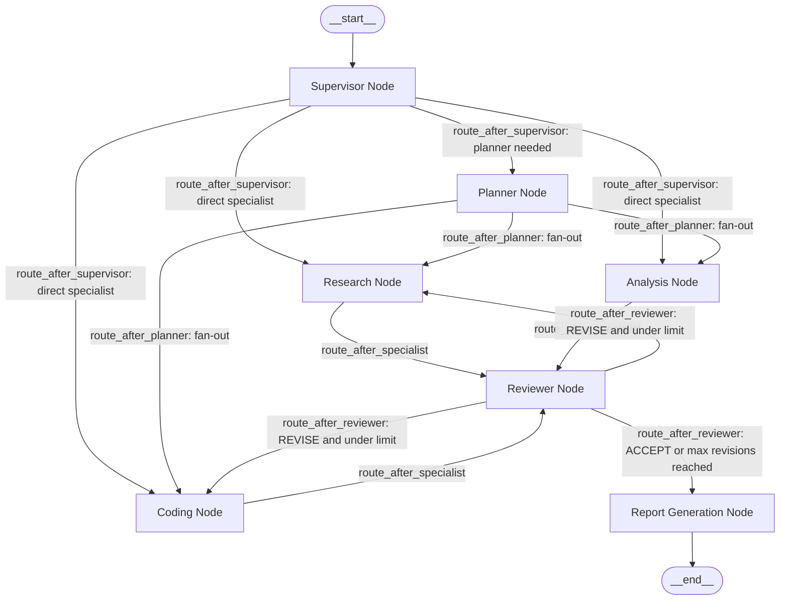

#### Diagram 2: Dynamic Conditional Routing Flow

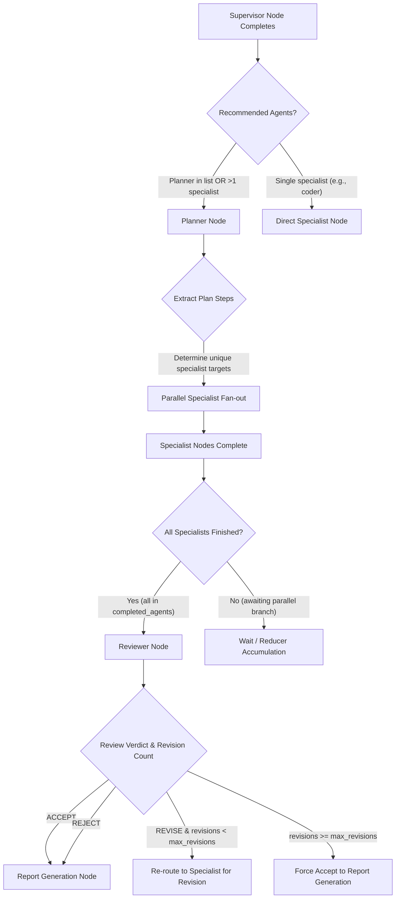

#### Diagram 3: Parallel Specialist Execution & Fan-Out / Fan-In Aggregation

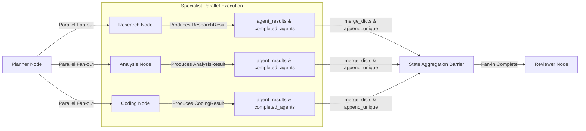

#### Diagram 4: Reviewer Feedback & Bounded Revision Loop

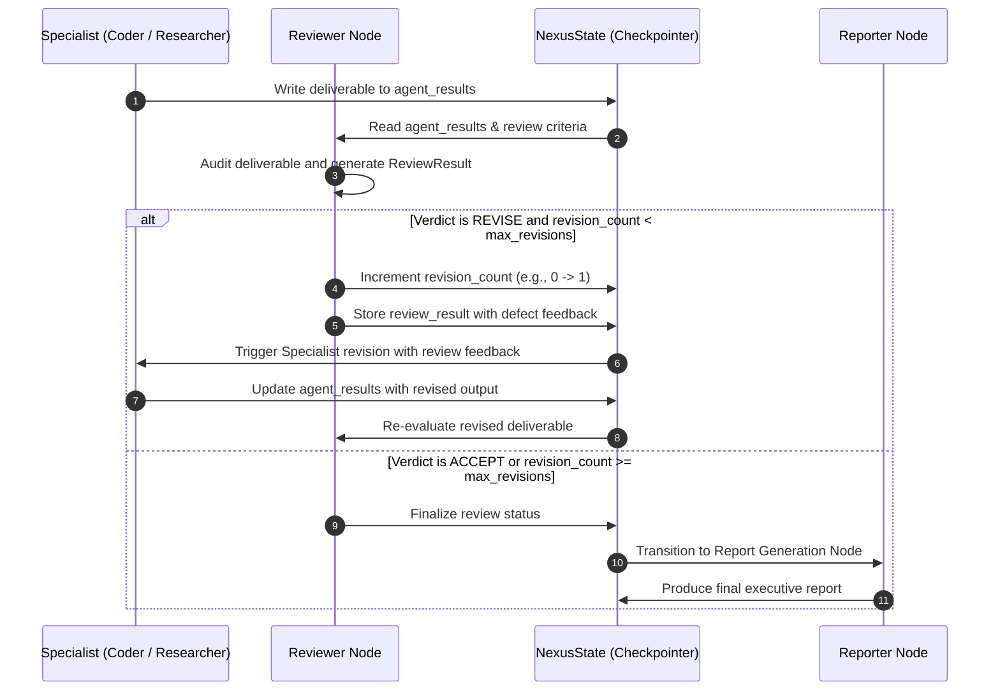

### 11.3 Checkpointing & Persistence Architecture

The engine implements a clear architectural separation between **ephemeral in-memory execution snapshots** and **durable relational persistence**:

1. **In-Memory Checkpointing (`WorkflowCheckpointAdapter`)**:
   - Implemented via `WorkflowCheckpointAdapter` wrapping LangGraph's `MemorySaver`.
   - Captures sub-step state transitions, node execution checkpoints, and internal graph state indexed by `thread_id` (workflow UUID).
   - Provides low-latency state retrieval via `GET /api/v1/workflows/{workflow_id}/state`.
   - **Cross-Process Limitation**: In-memory checkpoints reside in process heap memory. If the application server restarts during execution, in-memory checkpoint history is lost.
2. **Durable Database Persistence (MySQL)**:
   - Primary persistence is maintained in MySQL tables via SQLAlchemy 2.0:
     - `workflows`: Stores workflow ID, prompt, overall status (`PENDING`, `RUNNING`, `COMPLETED`, `FAILED`), configuration, metadata, and timestamps.
     - `tasks`: Created and updated for every agent node execution, recording agent role, individual task status, inputs, results, and execution latency.
     - `agent_executions` & `llm_usage_costs`: Audits all underlying LLM calls, token usage, and dollar costs.
   - Durability is guaranteed regardless of server reboots, worker restarts, or memory clearing.

---

## 12. Example Workflow Execution

### Trigger Multi-Agent Workflow

**Request:**
```bash
curl -X POST http://localhost:8000/api/v1/workflows/execute \
  -H "Content-Type: application/json" \
  -d '{
    "task_description": "Build an asynchronous rate limiter middleware for FastAPI using Redis token bucket algorithm.",
    "context": {"capacity": 100, "refill_rate": 10},
    "max_revisions": 2
  }'
```

**Response (200 OK):**
```json
{
  "workflow_id": "9b1deb4d-3b7d-4bad-9bdd-2b0d7b3dcb6d",
  "status": "COMPLETED",
  "task_description": "Build an asynchronous rate limiter middleware for FastAPI using Redis token bucket algorithm.",
  "final_output": {
    "report_title": "Executive Delivery: FastAPI Redis Rate Limiter Middleware",
    "executive_summary": "Architected, generated, peer-reviewed, and verified an asynchronous token-bucket rate limiter middleware.",
    "key_findings": [
      "Token bucket algorithm implemented via Redis atomic Lua script to prevent race conditions.",
      "Reviewer verified edge cases including Redis connection dropouts and non-burst traffic."
    ],
    "actionable_recommendations": [
      "Deploy Redis cluster with sentinel for high availability.",
      "Add Prometheus metrics tracking rejected 429 requests."
    ]
  },
  "completed_agents": [
    "supervisor",
    "planner",
    "coder",
    "reviewer",
    "reporter"
  ],
  "revision_count": 0,
  "execution_time_ms": 3420,
  "errors": [],
  "created_at": "2026-11-08T18:00:00.000000Z",
  "updated_at": "2026-11-08T18:00:03.420000Z"
}
```

---

## 13. Dynamic Planning & Intelligent Task Decomposition Engine (Milestone 5)

Milestone 5 introduces an intelligent, autonomous planning subsystem transforming complex objectives into validated, dependency-aware, prioritized execution plans.

### 13.1 Subsystem Architecture & Features

- **Task Decomposition (`TaskDecomposer`)**: Integrates directly with the registered `PlannerAgent` and official Google GenAI SDK to decompose goals into atomic `PlannedTask` items.
- **Agent Capability Matcher (`AgentCapabilityMatcher`)**: Deterministically aligns tasks to available registered agents (`supervisor`, `planner`, `researcher`, `analyst`, `coder`, `reviewer`, `reporter`) based on supported task types and capabilities without class instantiation hazards.
- **Dependency Graph Engine (`DependencyGraph`)**: Pure Python Directed Acyclic Graph (DAG) using Kahn's algorithm for topological sorting, 3-color DFS cycle detection, self-dependency prevention, and parallel level grouping.
- **Critical Path Prioritization (`TaskPrioritizer`)**: Calculates explainable priorities (`CRITICAL`, `HIGH`, `MEDIUM`, `LOW`) based on critical path length and downstream dependency block counts without violating mandatory DAG order.
- **Parallel Stage Generation (`StageGenerator`)**: Groups mutually independent tasks into concurrent `ExecutionStage` phases respecting configurable concurrency limits (`max_concurrency`).
- **Strict Plan Validation & Repair (`PlanValidator`)**: Audits task uniqueness, dependency validity, agent availability, and stage constraints; coordinates bounded iterative repair loops.
- **Conservative Plan Optimization (`PlanOptimizer`)**: Eliminates redundant transitive dependencies and merges duplicate subtasks while strictly preserving logical reachability.
- **Database Persistence**: Stores approved plans and iteration histories in MySQL (`execution_plans` and `planning_iterations` tables) via Alembic migration `0004`.

### 13.2 Planning Architectural Diagrams

#### Diagram 1: Dynamic Planning Subsystem Lifecycle

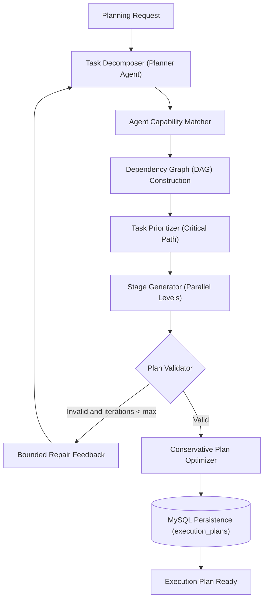

#### Diagram 2: Task Dependency Directed Acyclic Graph (DAG)

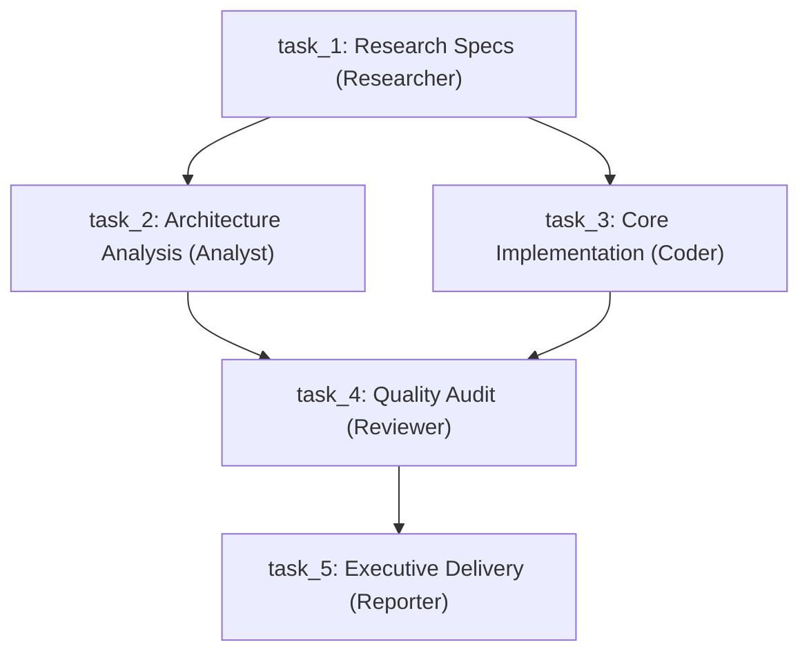

#### Diagram 3: Agent Capability Matching Subsystem

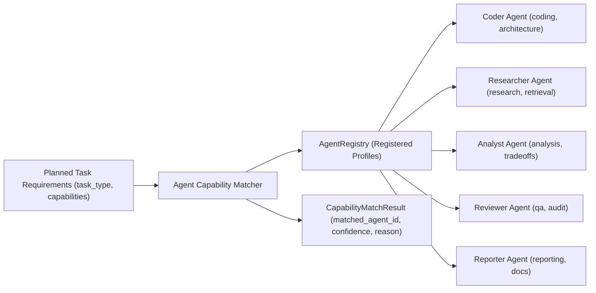

#### Diagram 4: Parallel Execution Stages Partitioning

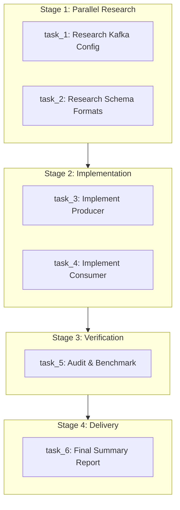

#### Diagram 5: Plan Validation and Bounded Iterative Repair

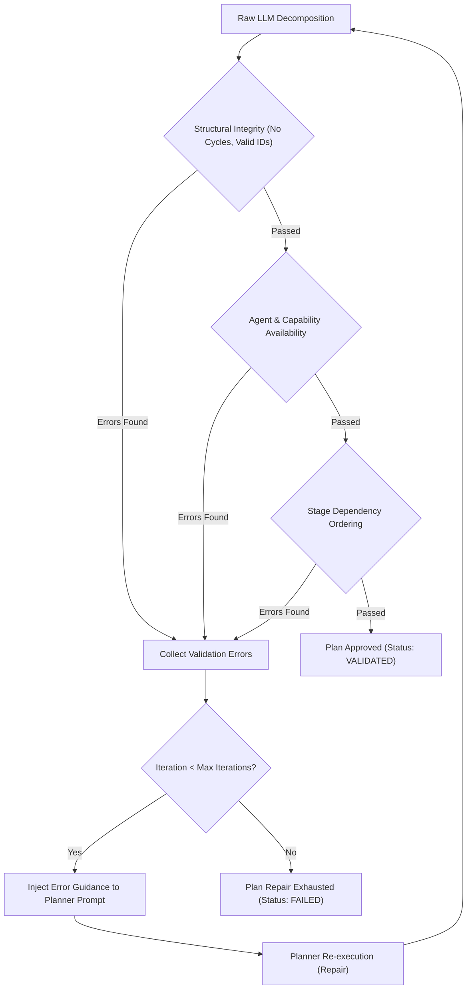

### 13.3 Example Generated Execution Plan

**Request:**
```bash
curl -X POST http://localhost:8000/api/v1/planning/generate \
  -H "Content-Type: application/json" \
  -d '{
    "user_request": "Build an asynchronous rate limiter middleware for FastAPI using Redis token bucket algorithm.",
    "constraints": ["Redis", "AsyncIO", "TokenBucket"],
    "max_tasks": 5,
    "max_planning_iterations": 3
  }'
```

**Response (200 OK):**
```json
{
  "plan_id": "8f3e5b62-38b9-4a92-91c2-19e34bcf9012",
  "workflow_id": null,
  "objective": "Build an asynchronous rate limiter middleware for FastAPI using Redis token bucket algorithm.",
  "tasks": [
    {
      "task_id": "task_1",
      "name": "Research Redis Rate Limiting Algorithms",
      "description": "Evaluate token bucket vs sliding window algorithms in Redis",
      "task_type": "research",
      "required_capabilities": ["information_synthesis"],
      "recommended_agent_id": "researcher",
      "dependencies": [],
      "priority": "HIGH",
      "expected_output": "Algorithm evaluation and Lua script specifications",
      "estimated_complexity": "moderate",
      "execution_constraints": {}
    },
    {
      "task_id": "task_2",
      "name": "Implement Redis Token Bucket Middleware",
      "description": "Write async FastAPI middleware executing atomic Lua script",
      "task_type": "coding",
      "required_capabilities": ["code_generation"],
      "recommended_agent_id": "coder",
      "dependencies": ["task_1"],
      "priority": "HIGH",
      "expected_output": "FastAPI middleware Python module",
      "estimated_complexity": "moderate",
      "execution_constraints": {}
    },
    {
      "task_id": "task_3",
      "name": "Peer Review and Edge Case Audit",
      "description": "Audit rate limiter against connection drops and concurrency races",
      "task_type": "review",
      "required_capabilities": ["quality_assurance"],
      "recommended_agent_id": "reviewer",
      "dependencies": ["task_2"],
      "priority": "LOW",
      "expected_output": "Verification verdict and recommendations",
      "estimated_complexity": "moderate",
      "execution_constraints": {}
    }
  ],
  "execution_stages": [
    {
      "stage_number": 1,
      "name": "Stage 1: Research",
      "tasks": [
        {
          "task_id": "task_1",
          "name": "Research Redis Rate Limiting Algorithms",
          "description": "Evaluate token bucket vs sliding window algorithms in Redis",
          "task_type": "research",
          "required_capabilities": ["information_synthesis"],
          "recommended_agent_id": "researcher",
          "dependencies": [],
          "priority": "HIGH",
          "expected_output": "Algorithm evaluation and Lua script specifications"
        }
      ],
      "can_run_parallel": false
    },
    {
      "stage_number": 2,
      "name": "Stage 2: Coding",
      "tasks": [
        {
          "task_id": "task_2",
          "name": "Implement Redis Token Bucket Middleware",
          "description": "Write async FastAPI middleware executing atomic Lua script",
          "task_type": "coding",
          "required_capabilities": ["code_generation"],
          "recommended_agent_id": "coder",
          "dependencies": ["task_1"],
          "priority": "HIGH",
          "expected_output": "FastAPI middleware Python module"
        }
      ],
      "can_run_parallel": false
    },
    {
      "stage_number": 3,
      "name": "Stage 3: Review",
      "tasks": [
        {
          "task_id": "task_3",
          "name": "Peer Review and Edge Case Audit",
          "description": "Audit rate limiter against connection drops and concurrency races",
          "task_type": "review",
          "required_capabilities": ["quality_assurance"],
          "recommended_agent_id": "reviewer",
          "dependencies": ["task_2"],
          "priority": "LOW",
          "expected_output": "Verification verdict and recommendations"
        }
      ],
      "can_run_parallel": false
    }
  ],
  "estimated_task_count": 3,
  "plan_status": "OPTIMIZED",
  "validation_errors": [],
  "metadata": {
    "total_planning_duration_ms": 280,
    "iterations_count": 1,
    "optimizations_applied": []
  },
  "created_at": "2026-11-08T19:00:00.000000Z"
}
```

---

## 14. Distributed Task Execution & Celery Infrastructure (Milestone 6)

Milestone 6 introduces **Distributed Asynchronous Task Execution** via **Celery** and **Redis**, decoupling long-running specialized agent workloads from the FastAPI HTTP process.

### Architecture Highlights:
- **Redis Message Broker**: Fast transient broker and result backend.
- **MySQL Durable Store**: Authoritative, ACID-compliant source of truth for workflow state, task tracking, and audit logs.
- **Payload Safety**: Celery messages carry strictly lightweight identifiers (`workflow_id`, `plan_id`, `planned_task_id`, `task_record_id`). Large prompts and context are hydrated directly from MySQL inside the worker.
- **Isolated Database Sessions (`NullPool`)**: Workers execute `asyncmy` operations inside worker processes using `create_async_engine(..., poolclass=NullPool)` to prevent connection pooling deadlocks and event loop conflicts.
- **Atomic Task Claiming & Idempotency**: Tasks are claimed atomically (`RUNNING`, `worker_id`, `started_at`). Completed or succeeded tasks skip execution idempotently upon duplicate delivery.
- **Fair Worker Dispatch**: `worker_prefetch_multiplier=1` ensures tasks are only fetched when a worker process is ready. Late ACKs (`task_acks_late=True`) re-queue crashed worker tasks.

### Logical Queues & Task Routing:

| Queue | Target Agent / Task Type | Celery Task Name |
| :--- | :--- | :--- |
| `research` | Information synthesis, web research, fact-checking | `app.workers.tasks.execution_tasks.execute_research_task` |
| `analysis` | Trade-off analysis, data evaluation, comparisons | `app.workers.tasks.execution_tasks.execute_analysis_task` |
| `coding` | Solution design, code generation, refactoring | `app.workers.tasks.execution_tasks.execute_coding_task` |
| `default` | General coordination, report generation, review | `app.workers.tasks.execution_tasks.execute_agent_task` |

### Distributed Execution Lifecycle:

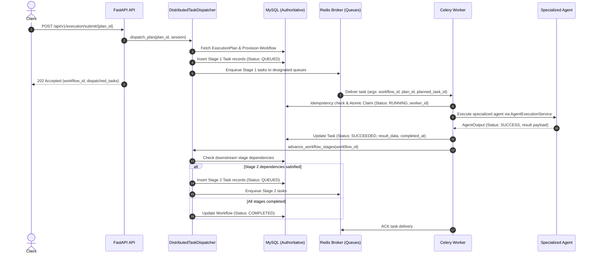

### Starting the Distributed Infrastructure:

#### 1. Start Redis
- **Windows (native / WSL2 / Memurai)**:
  ```bash
  redis-server
  ```
- **Docker (if available)**:
  ```bash
  docker run -d --name nexus-redis -p 6379:6379 redis:7-alpine
  ```

#### 2. Launch Celery Worker Fleet
- **Windows (Single Process / Solo Pool)**:
  ```powershell
  # Start worker consuming all agent queues
  uv run celery -A app.workers.celery_app worker --loglevel=info -P solo -Q default,research,analysis,coding
  ```
- **Linux / WSL2 (Prefork Pool)**:
  ```bash
  uv run celery -A app.workers.celery_app worker --loglevel=info -P prefork --concurrency=4 -Q default,research,analysis,coding
  ```

### Execution & Worker REST API Endpoints:

| Method | Endpoint | Description |
| :--- | :--- | :--- |
| `POST` | `/api/v1/execution/submit/{plan_id}` | Dispatches Stage 1 tasks of an execution plan to Celery worker queues (202 Accepted) |
| `GET` | `/api/v1/execution/{workflow_id}` | Retrieves execution progress, task status counts, and elapsed duration |
| `GET` | `/api/v1/execution/{workflow_id}/tasks` | Lists all distributed task tracking records for a workflow execution |
| `GET` | `/api/v1/execution/tasks/{task_id}` | Retrieves full task detail including input parameters, results, worker node, and retries |
| `GET` | `/api/v1/workers/health` | Diagnostic probe for Redis broker and active Celery worker fleet |
| `GET` | `/api/v1/workers` | Lists active Celery worker nodes, assigned queues, and running workloads |

---

## 15. Fault Tolerance, Recovery & Self-Healing Architecture

NEXUS AI incorporates a comprehensive self-healing subsystem designed for zero deliverable loss across crashes, network partitions, worker loss, and LLM rate-limiting.

### Core Resilience Mechanisms:

1. **Database-Backed Task Leases (`TaskLeaseManager`)**:
   - Every worker must atomically acquire a time-bounded lease before processing a task via conditional SQL `UPDATE tasks SET lease_token = :token, lease_expires_at = :expires WHERE id = :id AND (lease_token IS NULL OR lease_expires_at < :now)`.
   - On completion, workers execute a Compare-And-Swap (CAS) release validating `lease_token`. If the lease expired and was reclaimed, the zombie worker is prevented from overwriting the task outcome.
2. **Worker Heartbeats & Failure Detection (`WorkerFailureDetector`)**:
   - Active Celery workers emit periodic heartbeats updating `worker_nodes.last_heartbeat`.
   - Failure detector classifies workers as `ONLINE` ($\le 60\text{s}$), `SUSPECTED` ($60\text{s} - 90\text{s}$), or `OFFLINE` ($> 90\text{s}$).
3. **Automated Task Recovery Manager (`TaskRecoveryManager`)**:
   - Periodically scans for expired leases or stuck tasks.
   - Evaluates retry budget (`max_recovery_attempts=3`). Re-enqueues eligible tasks with fresh Celery job IDs or marks them terminal `FAILED`.
   - Appends an immutable audit event to `recovery_events`.
4. **Resilient LLM Circuit Breaker (`CircuitBreaker`)**:
   - 3-state machine (`CLOSED`, `OPEN`, `HALF_OPEN`) wrapping upstream Google Gemini API calls.
   - Trips to `OPEN` on consecutive errors ($\ge 5$), fast-failing downstream requests without wasting budget.
   - Probes upstream service after cooldown (`recovery_timeout=30s`) in `HALF_OPEN` state, resetting to `CLOSED` upon 2 consecutive successes.
5. **DAG-Aware Workflow Resumption (`WorkflowRecoveryService`)**:
   - Recovers from application/process restarts by inspecting execution plan DAG stages.
   - Preserves all completed (`SUCCEEDED`) subtasks and their stored deliverables.
   - Computes dependency satisfaction and re-dispatches only unblocked incomplete tasks.
6. **Graceful Workflow Cancellation (`WorkflowCancellationService`)**:
   - Revokes active in-flight Celery tasks via `celery_app.control.revoke(terminate=True)`.
   - Transitions remaining tasks to `CANCELLED` while preserving all prior `SUCCEEDED` deliverables.
7. **Periodic Celery Beat Recovery Scheduler (`app.workers.scheduler`)**:
   - Background periodic tasks running every 60s (`recover_orphaned_tasks`) and 30s (`detect_worker_heartbeat_failures`).

### Recovery Lifecycle Diagram:

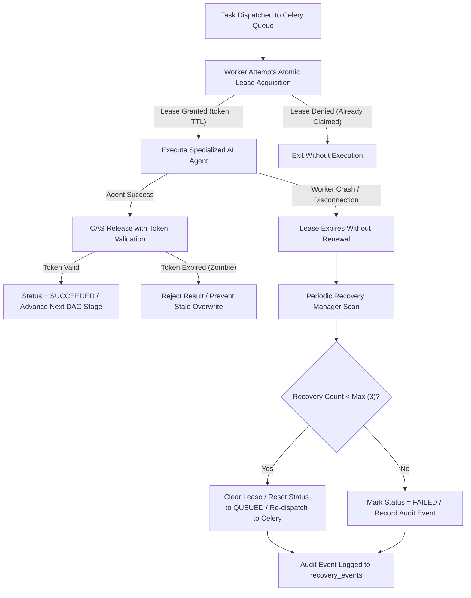

### Self-Healing & Recovery REST API Endpoints:

| Method | Endpoint | Description |
| :--- | :--- | :--- |
| `GET` | `/api/v1/recovery/health` | Comprehensive recovery diagnostic: active workers, unhealthy count, circuit breaker status |
| `GET` | `/api/v1/recovery/workers` | Lists all registered Celery workers with last recorded heartbeats and operational statuses |
| `GET` | `/api/v1/recovery/tasks/expired` | Lists all tasks currently in `RUNNING` status whose lease has expired |
| `GET` | `/api/v1/recovery/tasks/stuck` | Lists tasks stuck in `RUNNING` state without active lease renewal |
| `POST` | `/api/v1/recovery/tasks/{task_id}` | Manually triggers self-healing recovery intervention for an individual task |
| `POST` | `/api/v1/recovery/workflows/{workflow_id}/resume` | Resumes an interrupted workflow, preserving finished deliverables and re-dispatching unblocked tasks |
| `POST` | `/api/v1/execution/{workflow_id}/cancel` | Safely revokes in-flight worker tasks and marks workflow `CANCELLED` while keeping prior deliverables intact |
| `GET` | `/api/v1/recovery/workflows/{workflow_id}/history` | Returns the immutable audit history of all recovery events and lease revocations for a workflow |

---

## 16. Automated Testing & Verification

Run the complete test suite (149 unit, integration, and fault-injection tests with 100% pass rate):

```bash
uv run pytest -v
```

Run test suite with code coverage (88% total coverage):

```bash
uv run pytest --cov=app --cov-report=term-missing tests/
```

Run fault-injection and recovery verification tests:

```bash
uv run pytest tests/test_fault_injection.py tests/test_recovery_api.py tests/unit/test_recovery.py -v
```

Run Ruff linter and formatting checks:

```bash
uv run ruff check .
uv run ruff format --check .
```
